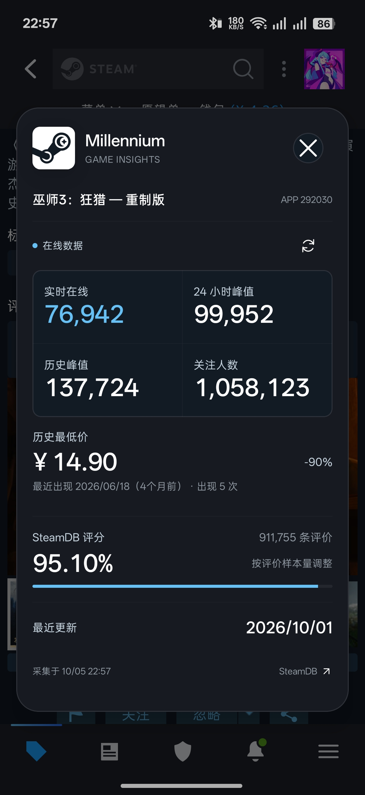
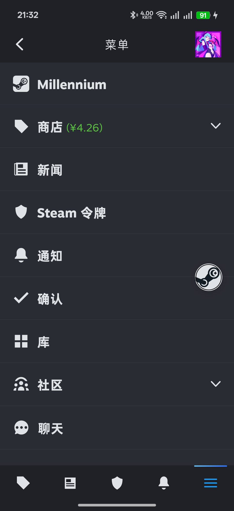
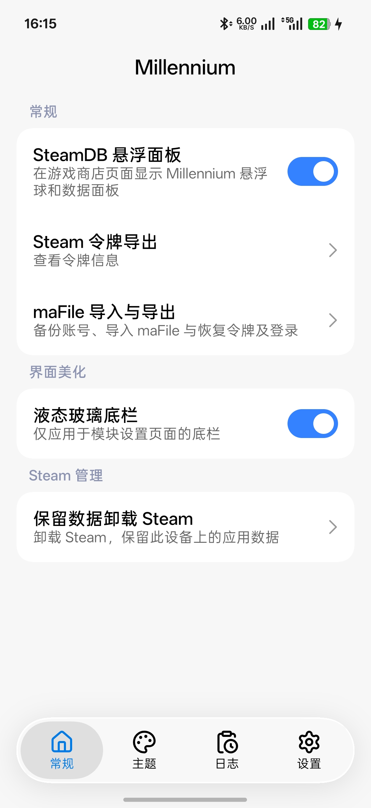
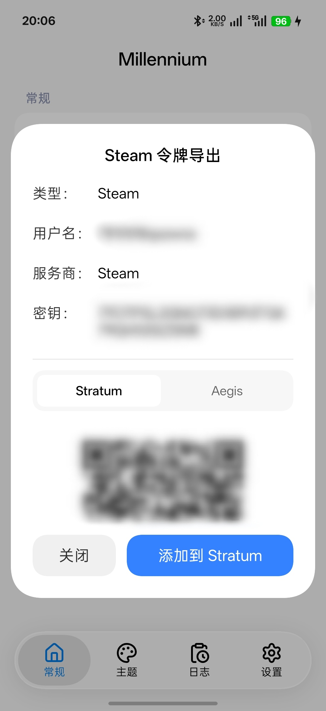

<a id="top"></a>

<p align="center">
  
</p>

<h1 align="center">Millennium</h1>

<p align="center">
  <strong>在 Steam 内查看 SteamDB 数据、导出令牌，通过 maFile 备份与恢复账号。</strong><br>
  基于现代 libxposed 的 Android Steam 增强模块。
</p>

<p align="center">
  <a href="README.md">English</a> •
  <a href="#features">核心功能</a> •
  <a href="#steam-guard">令牌导出</a> •
  <a href="#mafile">maFile 与恢复</a> •
  <a href="#quick-start">快速开始</a> •
  <a href="https://github.com/Good-Joe2049/Millennium/issues">问题反馈</a>
</p>

<p align="center">
  <a href="https://github.com/Good-Joe2049/Millennium/releases/latest"></a>
  <a href="https://github.com/Good-Joe2049/Millennium/releases"></a>
  <a href="https://github.com/Good-Joe2049/Millennium/commits/main/"></a>
  <a href="https://t.me/MillenniumXposed"></a>
  
  
  
  <a href="LICENSE"></a>
</p>

<table align="center">
  <tr>
    <td width="25%" align="center" valign="top">
      <a href="docs/images/panel-witcher3.jpg"></a><br>
      <sub>SteamDB 悬浮面板</sub>
    </td>
    <td width="25%" align="center" valign="top">
      <a href="docs/images/steam-menu-preview.jpg"></a><br>
      <sub>Steam 菜单入口</sub>
    </td>
    <td width="25%" align="center" valign="top">
      <a href="docs/images/module-settings-preview.jpg"></a><br>
      <sub>模块设置主页</sub>
    </td>
    <td width="25%" align="center" valign="top">
      <a href="docs/images/steam-guard-export-preview.jpg"></a><br>
      <sub>Steam 令牌导出</sub>
    </td>
  </tr>
</table>

---

**Millennium** 将游戏数据、价格记录、令牌导出及 maFile 备份与恢复整合进 Android 版 Steam。在游戏商店详情页打开 SteamDB 悬浮面板，或从 Steam 菜单中位于“商店”上方的 **Millennium** 入口管理模块。

**v1.1.5 已通过真机验证：** 将 maFile 导入另一台已登录相同账号的手机后，可在官方 Steam 中恢复动态验证码和登录批准功能，两台手机能够同时生成一致的验证码。

<a id="features"></a>

## ✨ 核心功能

| 功能 | 可以查看或完成什么 |
| :--- | :--- |
| **SteamDB 悬浮面板** | 实时在线人数、24 小时峰值、历史峰值、关注数、历史最低价、SteamDB 评分和最近更新日期。 |
| **价格记录** | 跟随商店币种与定价地区，显示可用的折扣、出现次数与日期；SteamDB 提供时，同时展示两年内最低价。 |
| **悬浮操作** | 拖动悬浮球、贴边并记住位置，手动刷新当前游戏数据，或在浏览器打开对应的 SteamDB 页面。 |
| **模块设置** | 全屏 miuix 界面，包含常规、主题、日志、设置四个底栏页面，支持左右滑动与页面过渡动画。 |
| **液态玻璃底栏** | 可选的玻璃效果，支持拖动选中胶囊、弹性反馈与光学效果，需要 Android 13 或更高版本。 |
| **Steam 令牌导出** | 查看类型、用户名、服务商和密钥，轻触数据即可复制；存在多个账号时可切换账号。 |
| **二维码与直接导入** | 在 Stratum 和 Aegis 两种格式之间切换，二维码带有形变过渡，也可直接打开选中的身份验证器导入。 |
| **maFile 导入与导出** | 备份账号、导入兼容的 maFile、预览字段并再次导出。直接显示明文，轻触即可复制完整内容，即使界面中已省略长值。 |
| **令牌与登录恢复** | 在下次完整启动 Steam 时恢复令牌数据和可用的登录凭据。按 SteamID 匹配并覆盖导入账号的数据，保留其他账号记录。 |
| **Steam 管理** | 授权 Shizuku/Sui 后，可卸载 Steam 并保留当前 Android 用户的本地应用数据。 |
| **模块语言** | 跟随系统、English、中文（简体），切换即时生效并保存选择。 |

<a id="interface"></a>

## 📱 界面与交互

模块设置采用 [miuix](https://github.com/compose-miuix-ui/miuix) 的卡片、开关、弹窗与选择菜单。既可以点击底栏，也可以左右滑动页面切换。

在 **常规 → 界面美化** 中开启 **液态玻璃底栏**，即可为模块底栏应用玻璃效果。选中胶囊可以在各个页面之间拖动；该效果仅用于模块设置页面，不改变 Steam 自带的底栏。

**SteamDB 悬浮面板**开关即时生效。**设置 → 语言**提供模块语言选择，不会修改 Steam 自身的语言。

**主题**和**日志**目前为占位页面，其中主题页面用于未来的 **Steam 主题**功能。配置备份与恢复，以及模块界面可选的深色、浅色、莫奈主题，也仍在规划中。

<a id="steam-guard"></a>

## 🔐 Steam 令牌导出

打开 **Steam → 菜单 → Millennium → 常规 → Steam 令牌导出**。

- **轻触复制**：每个数据值都有独立的按压反馈，复制后显示剪贴板提示。
- **扫码导入**：选择 Stratum 或 Aegis，显示对应格式的二维码，一次只展示一个。
- **直接添加**：点击 **添加到 Stratum** 或 **添加到 Aegis**，使用正确格式的链接打开对应软件，无需手动输入密钥或扫码。

| 身份验证器 | 直接导入时的预期流程 |
| :--- | :--- |
| [Stratum](https://github.com/stratumauth/app) | 打开应用后添加 Steam 令牌；如有应用锁，需要先解锁。 |
| [Aegis](https://github.com/beemdevelopment/aegis) | 打开已经填好数据的页面，确认后保存；如有解锁提示，先完成验证。 |

两款软件使用不同的 Steam 链接格式，Millennium 会为二维码和直接导入选择各自对应的格式。请先安装并完成身份验证器的初始化；具体确认流程可能随其版本变化。

二维码在设备本地生成。模块已取消“启动 Steam 后自动复制令牌数据到剪贴板”的旧行为。如果暂时没有获取到数据，请先打开 Steam 的**令牌**页面，再返回导出弹窗。

<a id="mafile"></a>

## 📦 maFile 导入、导出与恢复

打开 **Steam → 菜单 → Millennium → 常规 → maFile 导入与导出**。

### 导出与兼容性

- 存在多个账号时先选择账号，再点击**导出文件**保存 `.maFile`。
- 显示已获取的用户名、SteamID、令牌密钥、设备标识、撤销码和登录凭据。**点击字段即可复制完整内容。** 长数据以单行省略号显示，复制和导出均保留完整原文。
- 导出时按 SteamID 匹配令牌数据与登录凭据，导入和再次导出时保留 maFile 中的额外字段。
- 兼容 **Monica Steam** 和 **Steam Desktop Authenticator（SDA）** 使用的单账号明文 maFile 格式。支持导入不超过 **1 MB** 的文件，暂不支持 ZIP 压缩包和加密备份。
- **已实测与 Monica Steam 互通：** 导出的 maFile 可用于多设备生成 Steam 动态验证码和登录批准。在 Monica 的 maFile 导入界面选择已保存的文件即可。

**从 Monica Steam 获取：** 导入页新增快捷入口，向同一 Android 用户或资料中兼容的 Monica Steam 请求一个账号。Monica 要求先配置主密码，每次重新解锁、选择账号并明确确认。模块通过绑定 UID 的短时授权读取一次 maFile，不保存明文临时文件，然后显示原有预览；仍需点击**导入**才会应用，不会在收到数据时自动导入或恢复。Steam 及其注入代码仍能永久保留已读到的凭据。

需要 Monica Steam 支持 [maFile 交付协议 v1](docs/monica-mafile-handoff.md)，目前配套实现正在加入其 1.0.310 开发版本。未安装或旧版可继续使用**选择 maFile 文件**。新快捷入口仍需 Steam／LSPosed 真机互通验证，上述文件互通的实测结果不代表此入口已通过验证。

### 在官方 Steam 中恢复

1. 在来源手机打开 Steam 的**令牌**页面，再通过 Millennium 导出该账号的 maFile。
2. 在已启用 Millennium 的目标手机上打开**导入**标签页，选择文件，核对账号后点击**导入**。
3. 导入会覆盖相同 **SteamID** 的已保存数据；宿主与凭据支持恢复时，会自动安排恢复。同一账号在列表中只显示一次。
4. 在 **Android 设置中强行停止 Steam，再重新打开**。仅切到后台再返回不会执行恢复。
5. 查看恢复状态和 Steam 的**令牌**页面。在线登录批准需要该账号的有效登录会话。

如果令牌数据可用，但登录凭据缺失、过期或无效，Millennium 会恢复令牌并保留当前登录会话。只包含可用登录凭据的文件可以恢复会话，但无法补齐缺失的令牌密钥。登录凭据是否有效由 Steam 联网验证。

恢复会保留其他账号记录；文件中的设备标识还会更新 Steam 的全局设备标识。支持重启前连续导入多个账号、取消待执行的恢复，也可点击**恢复账号数据**再次安排恢复。

已导入账号和恢复备份加密保存在应用私有目录。写入失败时会尝试回滚，操作中断后不会自动重复执行。**撤销**仅在当前数据仍与恢复记录匹配时还原之前的状态。恢复成功后，导出会使用 Steam 当前的登录凭据。

<a id="steam-management"></a>

## 🧰 Steam 管理

确保服务已启动，在 **设置 → 工作模式 → Shizuku(Sui)** 中完成授权。只有授权成功后才会启用该模式。

在 **常规 → Steam 管理** 中，**保留数据卸载 Steam** 可卸载 Steam，同时保留当前 Android 用户的应用数据。操作开始后 Steam 会关闭。重新安装时需要使用相同签名的安装包；官方版与 NPatch 修改版可能使用不同签名。保留应用数据不能代替 maFile 备份。

<a id="quick-start"></a>

## 🚀 快速开始

### 环境要求

| 项目 | 要求 |
| :--- | :--- |
| Android | Android 8.0 / API 26 或更高版本，同时满足所用 Xposed 框架的要求。 |
| 架构 | `arm64-v8a`。 |
| 独立模块所需框架 | **核心支持现代 libxposed API 102** 的 LSPosed 或兼容框架。 |
| 目标应用 | Android 版 Steam：`com.valvesoftware.android.steam.community`。 |
| 可选效果 | 液态玻璃需要 Android 13 或更高版本；较早的系统使用普通模块底栏。 |
| 可选管理服务 | 执行 Steam 管理操作时，需要已启动并授权的 Shizuku 或 Sui。 |

### 版本下载

[GitHub Releases](https://github.com/Good-Joe2049/Millennium/releases/latest) 提供最新文件和更新说明。v1.1.5 包含：

| 文件 | 用途 |
| :--- | :--- |
| `Millennium-v1.1.5-arm64-v8a.apk` | 独立模块，按下方框架安装步骤使用。 |
| `steam-1.1.5-npatched.apk` | 经 NPatch 修补的 Steam 安装包，与独立模块分开提供。 |

### 通过框架安装

1. 从 [GitHub Releases](https://github.com/Good-Joe2049/Millennium/releases) 下载并安装模块 APK。
2. 在 Xposed 框架管理器中启用 **Millennium**。
3. 在模块作用域中勾选 **Steam**。
4. **强制停止 Steam，再重新打开**，让框架加载模块。
5. 打开 Steam 底栏最右侧的**菜单**，点击“商店”上方的 **Millennium**。
6. 进入某款游戏的商店详情页，点击悬浮球查看数据；令牌导出与 maFile 导入导出位于模块的常规页面。

悬浮面板附着在 Steam 自身的窗口中，无需申请 Android 的“显示在其他应用上层”权限。

<a id="data"></a>

## 📊 数据来源

- **实时在线人数**：优先使用 Steam 官方接口，SteamDB 作为后备。
- **峰值、关注数与最近更新**：来自 SteamDB 游戏信息。
- **历史最低价**：来自当前商店币种与定价地区对应的 SteamDB 价格记录。
- **SteamDB 评分**：读取商店页面的好评与差评数量，在本地按 SteamDB 公式计算。

数据可用性取决于上游服务和当前 Steam 页面；缺失字段会显示为不可用，不会当作零值。

<a id="faq"></a>

## 💬 常见问题

<details>
<summary><strong>为什么看不到菜单入口或悬浮球？</strong></summary>

确认模块已启用、作用域选择了 Steam，且框架核心支持 API 102，然后强制停止并重新打开 Steam。已有 Millennium 入口时，请检查 SteamDB 悬浮面板开关。

当前菜单识别支持中文“商店”和英文“Store”。切换模块语言不会扩展 Steam 菜单语言的兼容范围；Steam 更新也可能需要相应适配。

</details>

<details>
<summary><strong>为什么部分数据不可用，或者与 Steam 显示的不一样？</strong></summary>

Steam 和 SteamDB 是不同的数据来源，可用性与更新时间可能不同。价格跟随商店的币种和定价地区，而非手机语言。SteamDB 评分会考虑评价样本量，因此不等于 Steam 的好评百分比。

</details>

<details>
<summary><strong>为什么直接导入时无法打开身份验证器？</strong></summary>

请在与 Steam 相同的 Android 用户或工作资料中安装并启用对应软件，并检查系统是否限制应用间启动。如果身份验证器已锁定，请完成密码或指纹验证。也可以使用二维码或逐项复制数据。

</details>

<details>
<summary><strong>为什么导入 maFile 后没有立即恢复 Steam 令牌？</strong></summary>

恢复会在下次完整启动 Steam 时执行。请确认弹窗显示已安排恢复，再到 Android 设置中强行停止 Steam 并重新打开。再次导入相同 SteamID 的文件，会替换该账号已保存的数据和待执行的请求。

若提示无法恢复，仍可保存文件并再次导出。只有登录凭据的文件无法恢复缺失的令牌密钥；登录批准还需要该账号的有效会话。反馈问题时请附上恢复状态和 Steam 版本。

</details>

<details>
<summary><strong>能否直接打开 Monica 并自动导入账号？</strong></summary>

**Monica Steam → Millennium** 可在兼容版本中使用“从 Monica Steam 获取”，并在 Monica 中授权。**Millennium → Monica Steam** 仍需先导出 maFile，再到 Monica Steam 的导入界面选择文件，尚未实现该方向的自动跳转导入。Stratum 和 Aegis 已支持从 Steam 令牌导出弹窗直接打开并带入数据。

</details>

<a id="build"></a>

## 🛠️ 从源码构建

```bash
git clone https://github.com/Good-Joe2049/Millennium.git
cd Millennium
```

在 Android Studio 中打开项目并同步 Gradle。当前配置使用 **Android SDK 37**、**JDK 25 Gradle Daemon 工具链**，Java 源码与目标编译级别为 **21**。请使用仓库自带的 Gradle Wrapper，依赖版本见 `gradle/libs.versions.toml`。

<details>
<summary><strong>构建命令与 APK 输出</strong></summary>

Windows / PowerShell：

```powershell
.\gradlew.bat :app:assembleDebug
.\gradlew.bat :app:assembleRelease
```

Linux / macOS：

```bash
chmod +x gradlew
./gradlew :app:assembleDebug
./gradlew :app:assembleRelease
```

产物分别位于 `app/build/outputs/apk/debug/` 和 `app/build/outputs/apk/release/`。Release 文件名遵循 `Millennium-v<versionName>-<ABI>.apk`，例如 `Millennium-v1.1.5-arm64-v8a.apk`。

Release 构建启用 R8 与资源缩减，请保留项目中的 ProGuard 规则。未签名的 Release APK 需要签名后才能安装，也可以通过 Android Studio 的 **Generate Signed App Bundle or APK → APK** 生成签名 APK。

</details>

<a id="contributing"></a>

## 🤝 反馈与贡献

欢迎通过 [Issues](https://github.com/Good-Joe2049/Millennium/issues) 和 [Pull Requests](https://github.com/Good-Joe2049/Millennium/pulls) 报告问题、提出建议或贡献改进。请附上设备与 Android 版本、框架与模块版本、Steam 版本、复现步骤及相关日志。商店数据问题请同时提供游戏链接或 AppID。

欢迎关注 [Telegram 频道](https://t.me/MillenniumXposed)，获取版本发布与项目进展。

导出的 maFile 包含明文凭据，会话诊断日志也可能包含登录令牌。分享截图或日志前，请遮挡账号信息、令牌密钥、access/refresh token 和二维码。请勿在 Issue 中附上未脱敏的 maFile。

## 🙏 致谢

- [SteamDB Browser Extension](https://github.com/SteamDatabase/BrowserExtension) — 数据字段、区域价格与评分算法参考。
- [libxposed](https://github.com/libxposed/api) — 现代 Xposed 模块 API。
- [miuix](https://github.com/compose-miuix-ui/miuix) — 模块设置的界面组件与交互。
- [AndroidLiquidGlass](https://github.com/Kyant0/AndroidLiquidGlass) — 液态玻璃效果。
- [Stratum](https://github.com/stratumauth/app) 与 [Aegis](https://github.com/beemdevelopment/aegis) — 开源身份验证器。
- [Steam Desktop Authenticator](https://github.com/Jessecar96/SteamDesktopAuthenticator) — Steam maFile、Steam Guard 与交易确认参考。
- [steamguard-cli](https://github.com/dyc3/steamguard-cli) — Steam Guard 登录、令牌迁移与确认协议参考。
- [AnotherVaporAuth](https://github.com/freefrank/AnotherVaporAuth) — Steam 移动验证器与登录批准参考。

## 📄 开源协议

Millennium 采用 **[MIT License](LICENSE)**。第三方代码、依赖和资源仍分别遵循其原始许可证。

本项目由社区独立开发，与 Valve、Steam 或 SteamDB 无官方隶属关系。

---

<p align="center">
  <a href="https://github.com/Good-Joe2049/Millennium/releases">版本下载</a> •
  <a href="https://github.com/Good-Joe2049/Millennium/issues">问题反馈</a> •
  <a href="https://t.me/MillenniumXposed">Telegram</a> •
  <a href="#top">返回顶部 ↑</a>
</p>
